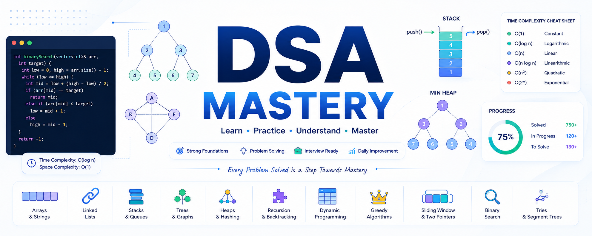
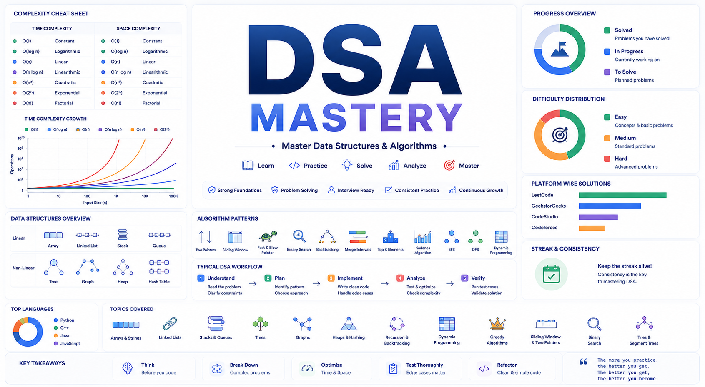

# DSA Mastery

> This repository documents my journey to mastering Data Structures and Algorithms (DSA). It contains solutions to coding problems, detailed explanations, algorithmic patterns, complexity analysis, and personal notes.

## Goals

- Build strong problem-solving skills
- Master core and advanced DSA concepts
- Develop interview-ready coding proficiency
- Maintain consistency through daily practice

## Topics Covered

- Arrays & Strings
- Linked Lists
- Stacks & Queues
- Trees & Graphs
- Heaps & Hashing
- Recursion & Backtracking
- Dynamic Programming
- Greedy Algorithms
- Sliding Window & Two Pointers
- Binary Search
- Tries & Segment Trees

Progress is tracked continuously as I solve and document new problems.

<!---LeetCode Topics Start-->
# LeetCode Topics
## Array
| Problem Name | Difficulty |
| ------- | ------- |
| [3093-longest-common-suffix-queries](https://github.com/sai4u-dev/dsa-mastery/tree/master/3093-longest-common-suffix-queries) |
| [3644-maximum-k-to-sort-a-permutation](https://github.com/sai4u-dev/dsa-mastery/tree/main/3644-maximum-k-to-sort-a-permutation/) | Medium |
| [3942-minimum-operations-to-sort-a-permutation](https://github.com/sai4u-dev/dsa-mastery/tree/main/LeetCode/Medium/3942-minimum-operations-to-sort-a-permutation/) | Medium |
## String
| Problem Name | Difficulty |
| ------- | ------- |
| [3093-longest-common-suffix-queries](https://github.com/sai4u-dev/dsa-mastery/tree/master/3093-longest-common-suffix-queries) |
## Trie
| Problem Name | Difficulty |
| ------- | ------- |
| [3093-longest-common-suffix-queries](https://github.com/sai4u-dev/dsa-mastery/tree/master/3093-longest-common-suffix-queries) |
## Bit Manipulation
| Problem Name | Difficulty |
| ------- | ------- |
| [3644-maximum-k-to-sort-a-permutation](https://github.com/sai4u-dev/dsa-mastery/tree/main/3644-maximum-k-to-sort-a-permutation/) | Medium |
<!---LeetCode Topics End-->