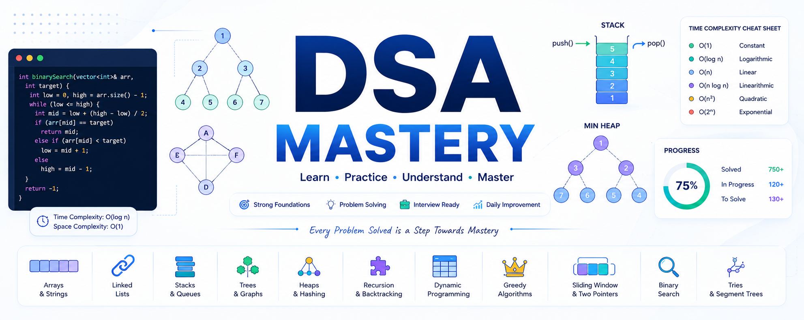
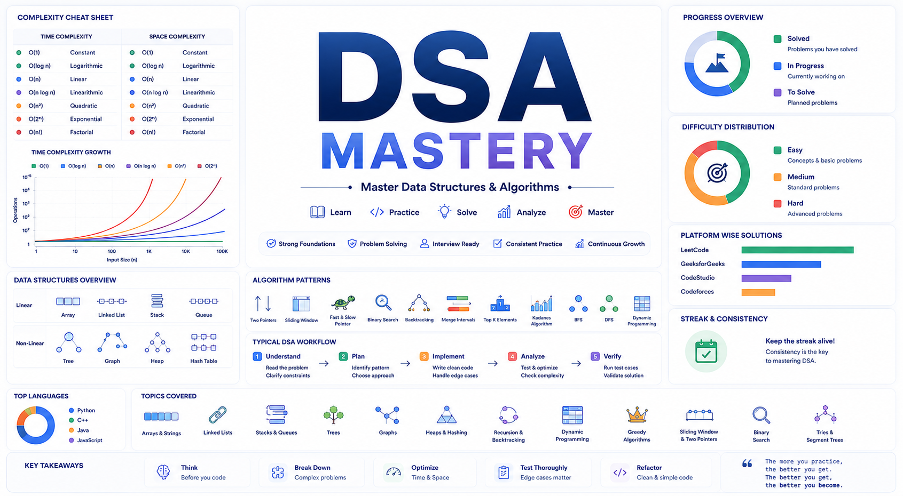

# DSA Mastery

> This repository documents my journey to mastering Data Structures and Algorithms (DSA). It contains solutions to coding problems, detailed explanations, algorithmic patterns, complexity analysis, and personal notes.

## Goals

- Build strong problem-solving skills
- Master core and advanced DSA concepts
- Develop interview-ready coding proficiency
- Maintain consistency through daily practice

## Topics Covered

- Arrays & Strings
- Linked Lists
- Stacks & Queues
- Trees & Graphs
- Heaps & Hashing
- Recursion & Backtracking
- Dynamic Programming
- Greedy Algorithms
- Sliding Window & Two Pointers
- Binary Search
- Tries & Segment Trees

Progress is tracked continuously as I solve and document new problems.

<!---LeetCode Topics Start-->
# LeetCode Topics
## Array
|  |
| ------- |
| [0001-two-sum](https://github.com/sai4u-dev/dsa-mastery/tree/main/0001-two-sum/) | Easy |
| [0027-remove-element](https://github.com/sai4u-dev/dsa-mastery/tree/main/0027-remove-element/) | Easy |
| [0042-trapping-rain-water](https://github.com/sai4u-dev/dsa-mastery/tree/master/0042-trapping-rain-water) |
| [0088-merge-sorted-array](https://github.com/sai4u-dev/dsa-mastery/tree/main/0088-merge-sorted-array/) | Easy |
| [0135-candy](https://github.com/sai4u-dev/dsa-mastery/tree/master/0135-candy) |
| [0453-minimum-moves-to-equal-array-elements](https://github.com/sai4u-dev/dsa-mastery/tree/main/0453-minimum-moves-to-equal-array-elements/) | Medium |
| [0462-minimum-moves-to-equal-array-elements-ii](https://github.com/sai4u-dev/dsa-mastery/tree/main/0462-minimum-moves-to-equal-array-elements-ii/) | Medium |
| [0746-min-cost-climbing-stairs](https://github.com/sai4u-dev/dsa-mastery/tree/main/0746-min-cost-climbing-stairs/) | Easy |
| [1254-number-of-closed-islands](https://github.com/sai4u-dev/dsa-mastery/tree/main/1254-number-of-closed-islands/) | Medium |
| [1385-find-the-distance-value-between-two-arrays](https://github.com/sai4u-dev/dsa-mastery/tree/main/1385-find-the-distance-value-between-two-arrays/) | Easy |
| [2747-count-zero-request-servers](https://github.com/sai4u-dev/dsa-mastery/tree/main/2747-count-zero-request-servers/) | Medium |
| [3093-longest-common-suffix-queries](https://github.com/sai4u-dev/dsa-mastery/tree/master/3093-longest-common-suffix-queries) |
| [3505-minimum-operations-to-make-elements-within-k-subarrays-equal](https://github.com/sai4u-dev/dsa-mastery/tree/main/3505-minimum-operations-to-make-elements-within-k-subarrays-equal/) | Hard |
| [3619-count-islands-with-total-value-divisible-by-k](https://github.com/sai4u-dev/dsa-mastery/tree/main/3619-count-islands-with-total-value-divisible-by-k/) | Medium |
| [3644-maximum-k-to-sort-a-permutation](https://github.com/sai4u-dev/dsa-mastery/tree/main/3644-maximum-k-to-sort-a-permutation/) | Medium |
| [3665-twisted-mirror-path-count](https://github.com/sai4u-dev/dsa-mastery/tree/main/3665-twisted-mirror-path-count/) | Medium |
| [3736-minimum-moves-to-equal-array-elements-iii](https://github.com/sai4u-dev/dsa-mastery/tree/main/3736-minimum-moves-to-equal-array-elements-iii/) | Easy |
| [3841-palindromic-path-queries-in-a-tree](https://github.com/sai4u-dev/dsa-mastery/tree/main/3841-palindromic-path-queries-in-a-tree/) | Hard |
| [3882-minimum-xor-path-in-a-grid](https://github.com/sai4u-dev/dsa-mastery/tree/main/3882-minimum-xor-path-in-a-grid/) | Medium |
| [3942-minimum-operations-to-sort-a-permutation](https://github.com/sai4u-dev/dsa-mastery/tree/main/LeetCode/Medium/3942-minimum-operations-to-sort-a-permutation/) | Medium |
## String
|  |
| ------- |
| [2409-count-days-spent-together](https://github.com/sai4u-dev/dsa-mastery/tree/master/2409-count-days-spent-together) |
| [3093-longest-common-suffix-queries](https://github.com/sai4u-dev/dsa-mastery/tree/master/3093-longest-common-suffix-queries) |
| [3841-palindromic-path-queries-in-a-tree](https://github.com/sai4u-dev/dsa-mastery/tree/main/3841-palindromic-path-queries-in-a-tree/) | Hard |
| [3970-shortest-path-with-at-most-k-consecutive-identical-characters](https://github.com/sai4u-dev/dsa-mastery/tree/main/3970-shortest-path-with-at-most-k-consecutive-identical-characters/) | Medium |
## Trie
|  |
| ------- |
| [3093-longest-common-suffix-queries](https://github.com/sai4u-dev/dsa-mastery/tree/master/3093-longest-common-suffix-queries) |
## Bit Manipulation
|  |
| ------- |
| [3644-maximum-k-to-sort-a-permutation](https://github.com/sai4u-dev/dsa-mastery/tree/main/3644-maximum-k-to-sort-a-permutation/) | Medium |
| [3841-palindromic-path-queries-in-a-tree](https://github.com/sai4u-dev/dsa-mastery/tree/main/3841-palindromic-path-queries-in-a-tree/) | Hard |
| [3882-minimum-xor-path-in-a-grid](https://github.com/sai4u-dev/dsa-mastery/tree/main/3882-minimum-xor-path-in-a-grid/) | Medium |
## Math
|  |
| ------- |
| [0319-bulb-switcher](https://github.com/sai4u-dev/dsa-mastery/tree/main/0319-bulb-switcher/) | Medium |
| [0453-minimum-moves-to-equal-array-elements](https://github.com/sai4u-dev/dsa-mastery/tree/main/0453-minimum-moves-to-equal-array-elements/) | Medium |
| [0462-minimum-moves-to-equal-array-elements-ii](https://github.com/sai4u-dev/dsa-mastery/tree/main/0462-minimum-moves-to-equal-array-elements-ii/) | Medium |
| [2409-count-days-spent-together](https://github.com/sai4u-dev/dsa-mastery/tree/master/2409-count-days-spent-together) |
| [3505-minimum-operations-to-make-elements-within-k-subarrays-equal](https://github.com/sai4u-dev/dsa-mastery/tree/main/3505-minimum-operations-to-make-elements-within-k-subarrays-equal/) | Hard |
| [3736-minimum-moves-to-equal-array-elements-iii](https://github.com/sai4u-dev/dsa-mastery/tree/main/3736-minimum-moves-to-equal-array-elements-iii/) | Easy |
## Depth-First Search
|  |
| ------- |
| [1254-number-of-closed-islands](https://github.com/sai4u-dev/dsa-mastery/tree/main/1254-number-of-closed-islands/) | Medium |
| [3619-count-islands-with-total-value-divisible-by-k](https://github.com/sai4u-dev/dsa-mastery/tree/main/3619-count-islands-with-total-value-divisible-by-k/) | Medium |
| [3841-palindromic-path-queries-in-a-tree](https://github.com/sai4u-dev/dsa-mastery/tree/main/3841-palindromic-path-queries-in-a-tree/) | Hard |
## Breadth-First Search
|  |
| ------- |
| [1254-number-of-closed-islands](https://github.com/sai4u-dev/dsa-mastery/tree/main/1254-number-of-closed-islands/) | Medium |
| [3619-count-islands-with-total-value-divisible-by-k](https://github.com/sai4u-dev/dsa-mastery/tree/main/3619-count-islands-with-total-value-divisible-by-k/) | Medium |
## Union-Find
|  |
| ------- |
| [1254-number-of-closed-islands](https://github.com/sai4u-dev/dsa-mastery/tree/main/1254-number-of-closed-islands/) | Medium |
| [3619-count-islands-with-total-value-divisible-by-k](https://github.com/sai4u-dev/dsa-mastery/tree/main/3619-count-islands-with-total-value-divisible-by-k/) | Medium |
## Matrix
|  |
| ------- |
| [1254-number-of-closed-islands](https://github.com/sai4u-dev/dsa-mastery/tree/main/1254-number-of-closed-islands/) | Medium |
| [3619-count-islands-with-total-value-divisible-by-k](https://github.com/sai4u-dev/dsa-mastery/tree/main/3619-count-islands-with-total-value-divisible-by-k/) | Medium |
| [3665-twisted-mirror-path-count](https://github.com/sai4u-dev/dsa-mastery/tree/main/3665-twisted-mirror-path-count/) | Medium |
| [3882-minimum-xor-path-in-a-grid](https://github.com/sai4u-dev/dsa-mastery/tree/main/3882-minimum-xor-path-in-a-grid/) | Medium |
## Dynamic Programming
|  |
| ------- |
| [0042-trapping-rain-water](https://github.com/sai4u-dev/dsa-mastery/tree/master/0042-trapping-rain-water) |
| [0746-min-cost-climbing-stairs](https://github.com/sai4u-dev/dsa-mastery/tree/main/0746-min-cost-climbing-stairs/) | Easy |
| [3505-minimum-operations-to-make-elements-within-k-subarrays-equal](https://github.com/sai4u-dev/dsa-mastery/tree/main/3505-minimum-operations-to-make-elements-within-k-subarrays-equal/) | Hard |
| [3665-twisted-mirror-path-count](https://github.com/sai4u-dev/dsa-mastery/tree/main/3665-twisted-mirror-path-count/) | Medium |
| [3882-minimum-xor-path-in-a-grid](https://github.com/sai4u-dev/dsa-mastery/tree/main/3882-minimum-xor-path-in-a-grid/) | Medium |
## Brainteaser
|  |
| ------- |
| [0319-bulb-switcher](https://github.com/sai4u-dev/dsa-mastery/tree/main/0319-bulb-switcher/) | Medium |
## Divide and Conquer
|  |
| ------- |
| [3841-palindromic-path-queries-in-a-tree](https://github.com/sai4u-dev/dsa-mastery/tree/main/3841-palindromic-path-queries-in-a-tree/) | Hard |
## Tree
|  |
| ------- |
| [3841-palindromic-path-queries-in-a-tree](https://github.com/sai4u-dev/dsa-mastery/tree/main/3841-palindromic-path-queries-in-a-tree/) | Hard |
## Binary Indexed Tree
|  |
| ------- |
| [3841-palindromic-path-queries-in-a-tree](https://github.com/sai4u-dev/dsa-mastery/tree/main/3841-palindromic-path-queries-in-a-tree/) | Hard |
## Segment Tree
|  |
| ------- |
| [3841-palindromic-path-queries-in-a-tree](https://github.com/sai4u-dev/dsa-mastery/tree/main/3841-palindromic-path-queries-in-a-tree/) | Hard |
## Hash Table
|  |
| ------- |
| [0001-two-sum](https://github.com/sai4u-dev/dsa-mastery/tree/main/0001-two-sum/) | Easy |
| [2747-count-zero-request-servers](https://github.com/sai4u-dev/dsa-mastery/tree/main/2747-count-zero-request-servers/) | Medium |
| [3505-minimum-operations-to-make-elements-within-k-subarrays-equal](https://github.com/sai4u-dev/dsa-mastery/tree/main/3505-minimum-operations-to-make-elements-within-k-subarrays-equal/) | Hard |
## Two Pointers
|  |
| ------- |
| [0027-remove-element](https://github.com/sai4u-dev/dsa-mastery/tree/main/0027-remove-element/) | Easy |
| [0042-trapping-rain-water](https://github.com/sai4u-dev/dsa-mastery/tree/master/0042-trapping-rain-water) |
| [0088-merge-sorted-array](https://github.com/sai4u-dev/dsa-mastery/tree/main/0088-merge-sorted-array/) | Easy |
| [1385-find-the-distance-value-between-two-arrays](https://github.com/sai4u-dev/dsa-mastery/tree/main/1385-find-the-distance-value-between-two-arrays/) | Easy |
## Sorting
|  |
| ------- |
| [0088-merge-sorted-array](https://github.com/sai4u-dev/dsa-mastery/tree/main/0088-merge-sorted-array/) | Easy |
| [0462-minimum-moves-to-equal-array-elements-ii](https://github.com/sai4u-dev/dsa-mastery/tree/main/0462-minimum-moves-to-equal-array-elements-ii/) | Medium |
| [1385-find-the-distance-value-between-two-arrays](https://github.com/sai4u-dev/dsa-mastery/tree/main/1385-find-the-distance-value-between-two-arrays/) | Easy |
| [2747-count-zero-request-servers](https://github.com/sai4u-dev/dsa-mastery/tree/main/2747-count-zero-request-servers/) | Medium |
## Graph Theory
|  |
| ------- |
| [3970-shortest-path-with-at-most-k-consecutive-identical-characters](https://github.com/sai4u-dev/dsa-mastery/tree/main/3970-shortest-path-with-at-most-k-consecutive-identical-characters/) | Medium |
## Heap (Priority Queue)
|  |
| ------- |
| [3505-minimum-operations-to-make-elements-within-k-subarrays-equal](https://github.com/sai4u-dev/dsa-mastery/tree/main/3505-minimum-operations-to-make-elements-within-k-subarrays-equal/) | Hard |
| [3970-shortest-path-with-at-most-k-consecutive-identical-characters](https://github.com/sai4u-dev/dsa-mastery/tree/main/3970-shortest-path-with-at-most-k-consecutive-identical-characters/) | Medium |
## Shortest Path
|  |
| ------- |
| [3970-shortest-path-with-at-most-k-consecutive-identical-characters](https://github.com/sai4u-dev/dsa-mastery/tree/main/3970-shortest-path-with-at-most-k-consecutive-identical-characters/) | Medium |
## Sliding Window
|  |
| ------- |
| [2747-count-zero-request-servers](https://github.com/sai4u-dev/dsa-mastery/tree/main/2747-count-zero-request-servers/) | Medium |
| [3505-minimum-operations-to-make-elements-within-k-subarrays-equal](https://github.com/sai4u-dev/dsa-mastery/tree/main/3505-minimum-operations-to-make-elements-within-k-subarrays-equal/) | Hard |
## Binary Search
|  |
| ------- |
| [1385-find-the-distance-value-between-two-arrays](https://github.com/sai4u-dev/dsa-mastery/tree/main/1385-find-the-distance-value-between-two-arrays/) | Easy |
## Greedy
|  |
| ------- |
| [0135-candy](https://github.com/sai4u-dev/dsa-mastery/tree/master/0135-candy) |
## Stack
|  |
| ------- |
| [0042-trapping-rain-water](https://github.com/sai4u-dev/dsa-mastery/tree/master/0042-trapping-rain-water) |
## Monotonic Stack
|  |
| ------- |
| [0042-trapping-rain-water](https://github.com/sai4u-dev/dsa-mastery/tree/master/0042-trapping-rain-water) |
<!---LeetCode Topics End-->