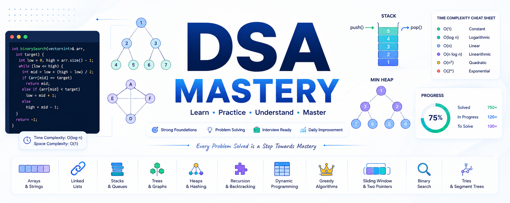
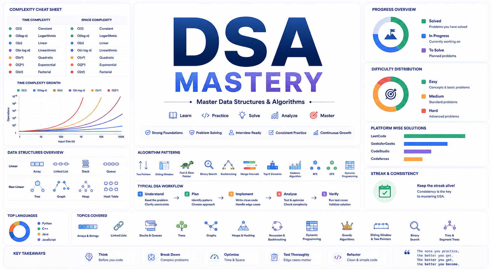

# DSA Mastery

> This repository documents my journey to mastering Data Structures and Algorithms (DSA). It contains solutions to coding problems, detailed explanations, algorithmic patterns, complexity analysis, and personal notes.

## Goals

- Build strong problem-solving skills
- Master core and advanced DSA concepts
- Develop interview-ready coding proficiency
- Maintain consistency through daily practice

## Topics Covered

- Arrays & Strings
- Linked Lists
- Stacks & Queues
- Trees & Graphs
- Heaps & Hashing
- Recursion & Backtracking
- Dynamic Programming
- Greedy Algorithms
- Sliding Window & Two Pointers
- Binary Search
- Tries & Segment Trees

Progress is tracked continuously as I solve and document new problems.

<!---LeetCode Topics Start-->
# LeetCode Topics
## Array
| Problem Name | Difficulty |
| ------- | ------- |
| [0001-two-sum](https://github.com/sai4u-dev/dsa-mastery/tree/main/0001-two-sum/) | Easy |
| [0011-container-with-most-water](https://github.com/sai4u-dev/dsa-mastery/tree/main/0011-container-with-most-water/) | Medium |
| [0015-3sum](https://github.com/sai4u-dev/dsa-mastery/tree/main/0015-3sum/) | Medium |
| [0026-remove-duplicates-from-sorted-array](https://github.com/sai4u-dev/dsa-mastery/tree/master/0026-remove-duplicates-from-sorted-array) |
| [0027-remove-element](https://github.com/sai4u-dev/dsa-mastery/tree/main/0027-remove-element/) | Easy |
| [0036-valid-sudoku](https://github.com/sai4u-dev/dsa-mastery/tree/master/0036-valid-sudoku) |
| [0042-trapping-rain-water](https://github.com/sai4u-dev/dsa-mastery/tree/master/0042-trapping-rain-water) |
| [0048-rotate-image](https://github.com/sai4u-dev/dsa-mastery/tree/main/0048-rotate-image/) | Medium |
| [0049-group-anagrams](https://github.com/sai4u-dev/dsa-mastery/tree/main/0049-group-anagrams/) | Medium |
| [0054-spiral-matrix](https://github.com/sai4u-dev/dsa-mastery/tree/main/0054-spiral-matrix/) | Medium |
| [0088-merge-sorted-array](https://github.com/sai4u-dev/dsa-mastery/tree/main/0088-merge-sorted-array/) | Easy |
| [0135-candy](https://github.com/sai4u-dev/dsa-mastery/tree/master/0135-candy) |
| [0167-two-sum-ii-input-array-is-sorted](https://github.com/sai4u-dev/dsa-mastery/tree/main/0167-two-sum-ii-input-array-is-sorted/) | Medium |
| [0209-minimum-size-subarray-sum](https://github.com/sai4u-dev/dsa-mastery/tree/main/0209-minimum-size-subarray-sum/) | Medium |
| [0453-minimum-moves-to-equal-array-elements](https://github.com/sai4u-dev/dsa-mastery/tree/main/0453-minimum-moves-to-equal-array-elements/) | Medium |
| [0462-minimum-moves-to-equal-array-elements-ii](https://github.com/sai4u-dev/dsa-mastery/tree/main/0462-minimum-moves-to-equal-array-elements-ii/) | Medium |
| [0706-design-hashmap](https://github.com/sai4u-dev/dsa-mastery/tree/main/0706-design-hashmap/) | Easy |
| [0746-min-cost-climbing-stairs](https://github.com/sai4u-dev/dsa-mastery/tree/main/0746-min-cost-climbing-stairs/) | Easy |
| [1254-number-of-closed-islands](https://github.com/sai4u-dev/dsa-mastery/tree/main/1254-number-of-closed-islands/) | Medium |
| [1267-count-servers-that-communicate](https://github.com/sai4u-dev/dsa-mastery/tree/main/1267-count-servers-that-communicate/) | Medium |
| [1352-product-of-the-last-k-numbers](https://github.com/sai4u-dev/dsa-mastery/tree/main/1352-product-of-the-last-k-numbers/) | Medium |
| [1385-find-the-distance-value-between-two-arrays](https://github.com/sai4u-dev/dsa-mastery/tree/main/1385-find-the-distance-value-between-two-arrays/) | Easy |
| [1524-number-of-sub-arrays-with-odd-sum](https://github.com/sai4u-dev/dsa-mastery/tree/main/1524-number-of-sub-arrays-with-odd-sum/) | Medium |
| [1606-find-servers-that-handled-most-number-of-requests](https://github.com/sai4u-dev/dsa-mastery/tree/main/1606-find-servers-that-handled-most-number-of-requests/) | Hard |
| [1882-process-tasks-using-servers](https://github.com/sai4u-dev/dsa-mastery/tree/main/1882-process-tasks-using-servers/) | Medium |
| [2747-count-zero-request-servers](https://github.com/sai4u-dev/dsa-mastery/tree/main/2747-count-zero-request-servers/) | Medium |
| [3041-maximize-consecutive-elements-in-an-array-after-modification](https://github.com/sai4u-dev/dsa-mastery/tree/main/3041-maximize-consecutive-elements-in-an-array-after-modification/) | Hard |
| [3093-longest-common-suffix-queries](https://github.com/sai4u-dev/dsa-mastery/tree/master/3093-longest-common-suffix-queries) |
| [3105-longest-strictly-increasing-or-strictly-decreasing-subarray](https://github.com/sai4u-dev/dsa-mastery/tree/main/3105-longest-strictly-increasing-or-strictly-decreasing-subarray/) | Easy |
| [3331-find-subtree-sizes-after-changes](https://github.com/sai4u-dev/dsa-mastery/tree/main/3331-find-subtree-sizes-after-changes/) | Medium |
| [3364-minimum-positive-sum-subarray](https://github.com/sai4u-dev/dsa-mastery/tree/master/3364-minimum-positive-sum-subarray) |
| [3411-maximum-subarray-with-equal-products](https://github.com/sai4u-dev/dsa-mastery/tree/main/3411-maximum-subarray-with-equal-products/) | Easy |
| [3420-count-non-decreasing-subarrays-after-k-operations](https://github.com/sai4u-dev/dsa-mastery/tree/main/3420-count-non-decreasing-subarrays-after-k-operations/) | Hard |
| [3505-minimum-operations-to-make-elements-within-k-subarrays-equal](https://github.com/sai4u-dev/dsa-mastery/tree/main/3505-minimum-operations-to-make-elements-within-k-subarrays-equal/) | Hard |
| [3619-count-islands-with-total-value-divisible-by-k](https://github.com/sai4u-dev/dsa-mastery/tree/main/3619-count-islands-with-total-value-divisible-by-k/) | Medium |
| [3644-maximum-k-to-sort-a-permutation](https://github.com/sai4u-dev/dsa-mastery/tree/main/3644-maximum-k-to-sort-a-permutation/) | Medium |
| [3665-twisted-mirror-path-count](https://github.com/sai4u-dev/dsa-mastery/tree/main/3665-twisted-mirror-path-count/) | Medium |
| [3693-climbing-stairs-ii](https://github.com/sai4u-dev/dsa-mastery/tree/master/3693-climbing-stairs-ii) |
| [3736-minimum-moves-to-equal-array-elements-iii](https://github.com/sai4u-dev/dsa-mastery/tree/main/3736-minimum-moves-to-equal-array-elements-iii/) | Easy |
| [3841-palindromic-path-queries-in-a-tree](https://github.com/sai4u-dev/dsa-mastery/tree/main/3841-palindromic-path-queries-in-a-tree/) | Hard |
| [3882-minimum-xor-path-in-a-grid](https://github.com/sai4u-dev/dsa-mastery/tree/main/3882-minimum-xor-path-in-a-grid/) | Medium |
| [3934-smallest-unique-subarray](https://github.com/sai4u-dev/dsa-mastery/tree/main/3934-smallest-unique-subarray/) | Hard |
| [3942-minimum-operations-to-sort-a-permutation](https://github.com/sai4u-dev/dsa-mastery/tree/main/LeetCode/Medium/3942-minimum-operations-to-sort-a-permutation/) | Medium |
## String
| Problem Name | Difficulty |
| ------- | ------- |
| [0003-longest-substring-without-repeating-characters](https://github.com/sai4u-dev/dsa-mastery/tree/master/0003-longest-substring-without-repeating-characters) |
| [0030-substring-with-concatenation-of-all-words](https://github.com/sai4u-dev/dsa-mastery/tree/main/0030-substring-with-concatenation-of-all-words/) | Hard |
| [0049-group-anagrams](https://github.com/sai4u-dev/dsa-mastery/tree/main/0049-group-anagrams/) | Medium |
| [0076-minimum-window-substring](https://github.com/sai4u-dev/dsa-mastery/tree/main/0076-minimum-window-substring/) | Hard |
| [0205-isomorphic-strings](https://github.com/sai4u-dev/dsa-mastery/tree/main/0205-isomorphic-strings/) | Easy |
| [0242-valid-anagram](https://github.com/sai4u-dev/dsa-mastery/tree/main/0242-valid-anagram/) | Easy |
| [0290-word-pattern](https://github.com/sai4u-dev/dsa-mastery/tree/main/0290-word-pattern/) | Easy |
| [0383-ransom-note](https://github.com/sai4u-dev/dsa-mastery/tree/main/0383-ransom-note/) | Easy |
| [0392-is-subsequence](https://github.com/sai4u-dev/dsa-mastery/tree/main/0392-is-subsequence/) | Easy |
| [2124-check-if-all-as-appears-before-all-bs](https://github.com/sai4u-dev/dsa-mastery/tree/main/2124-check-if-all-as-appears-before-all-bs/) | Easy |
| [2243-calculate-digit-sum-of-a-string](https://github.com/sai4u-dev/dsa-mastery/tree/main/2243-calculate-digit-sum-of-a-string/) | Easy |
| [2409-count-days-spent-together](https://github.com/sai4u-dev/dsa-mastery/tree/master/2409-count-days-spent-together) |
| [2911-minimum-changes-to-make-k-semi-palindromes](https://github.com/sai4u-dev/dsa-mastery/tree/main/2911-minimum-changes-to-make-k-semi-palindromes/) | Hard |
| [3093-longest-common-suffix-queries](https://github.com/sai4u-dev/dsa-mastery/tree/master/3093-longest-common-suffix-queries) |
| [3331-find-subtree-sizes-after-changes](https://github.com/sai4u-dev/dsa-mastery/tree/main/3331-find-subtree-sizes-after-changes/) | Medium |
| [3841-palindromic-path-queries-in-a-tree](https://github.com/sai4u-dev/dsa-mastery/tree/main/3841-palindromic-path-queries-in-a-tree/) | Hard |
| [3970-shortest-path-with-at-most-k-consecutive-identical-characters](https://github.com/sai4u-dev/dsa-mastery/tree/main/3970-shortest-path-with-at-most-k-consecutive-identical-characters/) | Medium |
## Trie
| Problem Name | Difficulty |
| ------- | ------- |
| [3093-longest-common-suffix-queries](https://github.com/sai4u-dev/dsa-mastery/tree/master/3093-longest-common-suffix-queries) |
## Bit Manipulation
| Problem Name | Difficulty |
| ------- | ------- |
| [3644-maximum-k-to-sort-a-permutation](https://github.com/sai4u-dev/dsa-mastery/tree/main/3644-maximum-k-to-sort-a-permutation/) | Medium |
| [3841-palindromic-path-queries-in-a-tree](https://github.com/sai4u-dev/dsa-mastery/tree/main/3841-palindromic-path-queries-in-a-tree/) | Hard |
| [3882-minimum-xor-path-in-a-grid](https://github.com/sai4u-dev/dsa-mastery/tree/main/3882-minimum-xor-path-in-a-grid/) | Medium |
## Math
| Problem Name | Difficulty |
| ------- | ------- |
| [0048-rotate-image](https://github.com/sai4u-dev/dsa-mastery/tree/main/0048-rotate-image/) | Medium |
| [0319-bulb-switcher](https://github.com/sai4u-dev/dsa-mastery/tree/main/0319-bulb-switcher/) | Medium |
| [0453-minimum-moves-to-equal-array-elements](https://github.com/sai4u-dev/dsa-mastery/tree/main/0453-minimum-moves-to-equal-array-elements/) | Medium |
| [0462-minimum-moves-to-equal-array-elements-ii](https://github.com/sai4u-dev/dsa-mastery/tree/main/0462-minimum-moves-to-equal-array-elements-ii/) | Medium |
| [1352-product-of-the-last-k-numbers](https://github.com/sai4u-dev/dsa-mastery/tree/main/1352-product-of-the-last-k-numbers/) | Medium |
| [1524-number-of-sub-arrays-with-odd-sum](https://github.com/sai4u-dev/dsa-mastery/tree/main/1524-number-of-sub-arrays-with-odd-sum/) | Medium |
| [2409-count-days-spent-together](https://github.com/sai4u-dev/dsa-mastery/tree/master/2409-count-days-spent-together) |
| [3360-stone-removal-game](https://github.com/sai4u-dev/dsa-mastery/tree/main/3360-stone-removal-game/) | Easy |
| [3411-maximum-subarray-with-equal-products](https://github.com/sai4u-dev/dsa-mastery/tree/main/3411-maximum-subarray-with-equal-products/) | Easy |
| [3505-minimum-operations-to-make-elements-within-k-subarrays-equal](https://github.com/sai4u-dev/dsa-mastery/tree/main/3505-minimum-operations-to-make-elements-within-k-subarrays-equal/) | Hard |
| [3736-minimum-moves-to-equal-array-elements-iii](https://github.com/sai4u-dev/dsa-mastery/tree/main/3736-minimum-moves-to-equal-array-elements-iii/) | Easy |
| [3789-minimum-cost-to-acquire-required-items](https://github.com/sai4u-dev/dsa-mastery/tree/main/3789-minimum-cost-to-acquire-required-items/) | Medium |
## Depth-First Search
| Problem Name | Difficulty |
| ------- | ------- |
| [1254-number-of-closed-islands](https://github.com/sai4u-dev/dsa-mastery/tree/main/1254-number-of-closed-islands/) | Medium |
| [1267-count-servers-that-communicate](https://github.com/sai4u-dev/dsa-mastery/tree/main/1267-count-servers-that-communicate/) | Medium |
| [3331-find-subtree-sizes-after-changes](https://github.com/sai4u-dev/dsa-mastery/tree/main/3331-find-subtree-sizes-after-changes/) | Medium |
| [3619-count-islands-with-total-value-divisible-by-k](https://github.com/sai4u-dev/dsa-mastery/tree/main/3619-count-islands-with-total-value-divisible-by-k/) | Medium |
| [3841-palindromic-path-queries-in-a-tree](https://github.com/sai4u-dev/dsa-mastery/tree/main/3841-palindromic-path-queries-in-a-tree/) | Hard |
## Breadth-First Search
| Problem Name | Difficulty |
| ------- | ------- |
| [1254-number-of-closed-islands](https://github.com/sai4u-dev/dsa-mastery/tree/main/1254-number-of-closed-islands/) | Medium |
| [1267-count-servers-that-communicate](https://github.com/sai4u-dev/dsa-mastery/tree/main/1267-count-servers-that-communicate/) | Medium |
| [3619-count-islands-with-total-value-divisible-by-k](https://github.com/sai4u-dev/dsa-mastery/tree/main/3619-count-islands-with-total-value-divisible-by-k/) | Medium |
## Union-Find
| Problem Name | Difficulty |
| ------- | ------- |
| [1254-number-of-closed-islands](https://github.com/sai4u-dev/dsa-mastery/tree/main/1254-number-of-closed-islands/) | Medium |
| [1267-count-servers-that-communicate](https://github.com/sai4u-dev/dsa-mastery/tree/main/1267-count-servers-that-communicate/) | Medium |
| [3619-count-islands-with-total-value-divisible-by-k](https://github.com/sai4u-dev/dsa-mastery/tree/main/3619-count-islands-with-total-value-divisible-by-k/) | Medium |
## Matrix
| Problem Name | Difficulty |
| ------- | ------- |
| [0036-valid-sudoku](https://github.com/sai4u-dev/dsa-mastery/tree/master/0036-valid-sudoku) |
| [0048-rotate-image](https://github.com/sai4u-dev/dsa-mastery/tree/main/0048-rotate-image/) | Medium |
| [0054-spiral-matrix](https://github.com/sai4u-dev/dsa-mastery/tree/main/0054-spiral-matrix/) | Medium |
| [1254-number-of-closed-islands](https://github.com/sai4u-dev/dsa-mastery/tree/main/1254-number-of-closed-islands/) | Medium |
| [1267-count-servers-that-communicate](https://github.com/sai4u-dev/dsa-mastery/tree/main/1267-count-servers-that-communicate/) | Medium |
| [3619-count-islands-with-total-value-divisible-by-k](https://github.com/sai4u-dev/dsa-mastery/tree/main/3619-count-islands-with-total-value-divisible-by-k/) | Medium |
| [3665-twisted-mirror-path-count](https://github.com/sai4u-dev/dsa-mastery/tree/main/3665-twisted-mirror-path-count/) | Medium |
| [3882-minimum-xor-path-in-a-grid](https://github.com/sai4u-dev/dsa-mastery/tree/main/3882-minimum-xor-path-in-a-grid/) | Medium |
## Dynamic Programming
| Problem Name | Difficulty |
| ------- | ------- |
| [0042-trapping-rain-water](https://github.com/sai4u-dev/dsa-mastery/tree/master/0042-trapping-rain-water) |
| [0392-is-subsequence](https://github.com/sai4u-dev/dsa-mastery/tree/main/0392-is-subsequence/) | Easy |
| [0746-min-cost-climbing-stairs](https://github.com/sai4u-dev/dsa-mastery/tree/main/0746-min-cost-climbing-stairs/) | Easy |
| [1524-number-of-sub-arrays-with-odd-sum](https://github.com/sai4u-dev/dsa-mastery/tree/main/1524-number-of-sub-arrays-with-odd-sum/) | Medium |
| [2911-minimum-changes-to-make-k-semi-palindromes](https://github.com/sai4u-dev/dsa-mastery/tree/main/2911-minimum-changes-to-make-k-semi-palindromes/) | Hard |
| [3041-maximize-consecutive-elements-in-an-array-after-modification](https://github.com/sai4u-dev/dsa-mastery/tree/main/3041-maximize-consecutive-elements-in-an-array-after-modification/) | Hard |
| [3505-minimum-operations-to-make-elements-within-k-subarrays-equal](https://github.com/sai4u-dev/dsa-mastery/tree/main/3505-minimum-operations-to-make-elements-within-k-subarrays-equal/) | Hard |
| [3665-twisted-mirror-path-count](https://github.com/sai4u-dev/dsa-mastery/tree/main/3665-twisted-mirror-path-count/) | Medium |
| [3693-climbing-stairs-ii](https://github.com/sai4u-dev/dsa-mastery/tree/master/3693-climbing-stairs-ii) |
| [3882-minimum-xor-path-in-a-grid](https://github.com/sai4u-dev/dsa-mastery/tree/main/3882-minimum-xor-path-in-a-grid/) | Medium |
## Brainteaser
| Problem Name | Difficulty |
| ------- | ------- |
| [0319-bulb-switcher](https://github.com/sai4u-dev/dsa-mastery/tree/main/0319-bulb-switcher/) | Medium |
## Divide and Conquer
| Problem Name | Difficulty |
| ------- | ------- |
| [3841-palindromic-path-queries-in-a-tree](https://github.com/sai4u-dev/dsa-mastery/tree/main/3841-palindromic-path-queries-in-a-tree/) | Hard |
## Tree
| Problem Name | Difficulty |
| ------- | ------- |
| [3331-find-subtree-sizes-after-changes](https://github.com/sai4u-dev/dsa-mastery/tree/main/3331-find-subtree-sizes-after-changes/) | Medium |
| [3841-palindromic-path-queries-in-a-tree](https://github.com/sai4u-dev/dsa-mastery/tree/main/3841-palindromic-path-queries-in-a-tree/) | Hard |
## Binary Indexed Tree
| Problem Name | Difficulty |
| ------- | ------- |
| [3841-palindromic-path-queries-in-a-tree](https://github.com/sai4u-dev/dsa-mastery/tree/main/3841-palindromic-path-queries-in-a-tree/) | Hard |
## Segment Tree
| Problem Name | Difficulty |
| ------- | ------- |
| [3420-count-non-decreasing-subarrays-after-k-operations](https://github.com/sai4u-dev/dsa-mastery/tree/main/3420-count-non-decreasing-subarrays-after-k-operations/) | Hard |
| [3841-palindromic-path-queries-in-a-tree](https://github.com/sai4u-dev/dsa-mastery/tree/main/3841-palindromic-path-queries-in-a-tree/) | Hard |
## Hash Table
| Problem Name | Difficulty |
| ------- | ------- |
| [0001-two-sum](https://github.com/sai4u-dev/dsa-mastery/tree/main/0001-two-sum/) | Easy |
| [0003-longest-substring-without-repeating-characters](https://github.com/sai4u-dev/dsa-mastery/tree/master/0003-longest-substring-without-repeating-characters) |
| [0030-substring-with-concatenation-of-all-words](https://github.com/sai4u-dev/dsa-mastery/tree/main/0030-substring-with-concatenation-of-all-words/) | Hard |
| [0036-valid-sudoku](https://github.com/sai4u-dev/dsa-mastery/tree/master/0036-valid-sudoku) |
| [0049-group-anagrams](https://github.com/sai4u-dev/dsa-mastery/tree/main/0049-group-anagrams/) | Medium |
| [0076-minimum-window-substring](https://github.com/sai4u-dev/dsa-mastery/tree/main/0076-minimum-window-substring/) | Hard |
| [0205-isomorphic-strings](https://github.com/sai4u-dev/dsa-mastery/tree/main/0205-isomorphic-strings/) | Easy |
| [0242-valid-anagram](https://github.com/sai4u-dev/dsa-mastery/tree/main/0242-valid-anagram/) | Easy |
| [0290-word-pattern](https://github.com/sai4u-dev/dsa-mastery/tree/main/0290-word-pattern/) | Easy |
| [0383-ransom-note](https://github.com/sai4u-dev/dsa-mastery/tree/main/0383-ransom-note/) | Easy |
| [0706-design-hashmap](https://github.com/sai4u-dev/dsa-mastery/tree/main/0706-design-hashmap/) | Easy |
| [2747-count-zero-request-servers](https://github.com/sai4u-dev/dsa-mastery/tree/main/2747-count-zero-request-servers/) | Medium |
| [3331-find-subtree-sizes-after-changes](https://github.com/sai4u-dev/dsa-mastery/tree/main/3331-find-subtree-sizes-after-changes/) | Medium |
| [3505-minimum-operations-to-make-elements-within-k-subarrays-equal](https://github.com/sai4u-dev/dsa-mastery/tree/main/3505-minimum-operations-to-make-elements-within-k-subarrays-equal/) | Hard |
| [3934-smallest-unique-subarray](https://github.com/sai4u-dev/dsa-mastery/tree/main/3934-smallest-unique-subarray/) | Hard |
## Two Pointers
| Problem Name | Difficulty |
| ------- | ------- |
| [0011-container-with-most-water](https://github.com/sai4u-dev/dsa-mastery/tree/main/0011-container-with-most-water/) | Medium |
| [0015-3sum](https://github.com/sai4u-dev/dsa-mastery/tree/main/0015-3sum/) | Medium |
| [0026-remove-duplicates-from-sorted-array](https://github.com/sai4u-dev/dsa-mastery/tree/master/0026-remove-duplicates-from-sorted-array) |
| [0027-remove-element](https://github.com/sai4u-dev/dsa-mastery/tree/main/0027-remove-element/) | Easy |
| [0042-trapping-rain-water](https://github.com/sai4u-dev/dsa-mastery/tree/master/0042-trapping-rain-water) |
| [0088-merge-sorted-array](https://github.com/sai4u-dev/dsa-mastery/tree/main/0088-merge-sorted-array/) | Easy |
| [0167-two-sum-ii-input-array-is-sorted](https://github.com/sai4u-dev/dsa-mastery/tree/main/0167-two-sum-ii-input-array-is-sorted/) | Medium |
| [0392-is-subsequence](https://github.com/sai4u-dev/dsa-mastery/tree/main/0392-is-subsequence/) | Easy |
| [1385-find-the-distance-value-between-two-arrays](https://github.com/sai4u-dev/dsa-mastery/tree/main/1385-find-the-distance-value-between-two-arrays/) | Easy |
| [2911-minimum-changes-to-make-k-semi-palindromes](https://github.com/sai4u-dev/dsa-mastery/tree/main/2911-minimum-changes-to-make-k-semi-palindromes/) | Hard |
## Sorting
| Problem Name | Difficulty |
| ------- | ------- |
| [0015-3sum](https://github.com/sai4u-dev/dsa-mastery/tree/main/0015-3sum/) | Medium |
| [0049-group-anagrams](https://github.com/sai4u-dev/dsa-mastery/tree/main/0049-group-anagrams/) | Medium |
| [0088-merge-sorted-array](https://github.com/sai4u-dev/dsa-mastery/tree/main/0088-merge-sorted-array/) | Easy |
| [0242-valid-anagram](https://github.com/sai4u-dev/dsa-mastery/tree/main/0242-valid-anagram/) | Easy |
| [0462-minimum-moves-to-equal-array-elements-ii](https://github.com/sai4u-dev/dsa-mastery/tree/main/0462-minimum-moves-to-equal-array-elements-ii/) | Medium |
| [1385-find-the-distance-value-between-two-arrays](https://github.com/sai4u-dev/dsa-mastery/tree/main/1385-find-the-distance-value-between-two-arrays/) | Easy |
| [2747-count-zero-request-servers](https://github.com/sai4u-dev/dsa-mastery/tree/main/2747-count-zero-request-servers/) | Medium |
| [3041-maximize-consecutive-elements-in-an-array-after-modification](https://github.com/sai4u-dev/dsa-mastery/tree/main/3041-maximize-consecutive-elements-in-an-array-after-modification/) | Hard |
## Graph Theory
| Problem Name | Difficulty |
| ------- | ------- |
| [3970-shortest-path-with-at-most-k-consecutive-identical-characters](https://github.com/sai4u-dev/dsa-mastery/tree/main/3970-shortest-path-with-at-most-k-consecutive-identical-characters/) | Medium |
## Heap (Priority Queue)
| Problem Name | Difficulty |
| ------- | ------- |
| [1606-find-servers-that-handled-most-number-of-requests](https://github.com/sai4u-dev/dsa-mastery/tree/main/1606-find-servers-that-handled-most-number-of-requests/) | Hard |
| [1882-process-tasks-using-servers](https://github.com/sai4u-dev/dsa-mastery/tree/main/1882-process-tasks-using-servers/) | Medium |
| [3505-minimum-operations-to-make-elements-within-k-subarrays-equal](https://github.com/sai4u-dev/dsa-mastery/tree/main/3505-minimum-operations-to-make-elements-within-k-subarrays-equal/) | Hard |
| [3970-shortest-path-with-at-most-k-consecutive-identical-characters](https://github.com/sai4u-dev/dsa-mastery/tree/main/3970-shortest-path-with-at-most-k-consecutive-identical-characters/) | Medium |
## Shortest Path
| Problem Name | Difficulty |
| ------- | ------- |
| [3970-shortest-path-with-at-most-k-consecutive-identical-characters](https://github.com/sai4u-dev/dsa-mastery/tree/main/3970-shortest-path-with-at-most-k-consecutive-identical-characters/) | Medium |
## Sliding Window
| Problem Name | Difficulty |
| ------- | ------- |
| [0003-longest-substring-without-repeating-characters](https://github.com/sai4u-dev/dsa-mastery/tree/master/0003-longest-substring-without-repeating-characters) |
| [0030-substring-with-concatenation-of-all-words](https://github.com/sai4u-dev/dsa-mastery/tree/main/0030-substring-with-concatenation-of-all-words/) | Hard |
| [0076-minimum-window-substring](https://github.com/sai4u-dev/dsa-mastery/tree/main/0076-minimum-window-substring/) | Hard |
| [0209-minimum-size-subarray-sum](https://github.com/sai4u-dev/dsa-mastery/tree/main/0209-minimum-size-subarray-sum/) | Medium |
| [2747-count-zero-request-servers](https://github.com/sai4u-dev/dsa-mastery/tree/main/2747-count-zero-request-servers/) | Medium |
| [3364-minimum-positive-sum-subarray](https://github.com/sai4u-dev/dsa-mastery/tree/master/3364-minimum-positive-sum-subarray) |
| [3411-maximum-subarray-with-equal-products](https://github.com/sai4u-dev/dsa-mastery/tree/main/3411-maximum-subarray-with-equal-products/) | Easy |
| [3420-count-non-decreasing-subarrays-after-k-operations](https://github.com/sai4u-dev/dsa-mastery/tree/main/3420-count-non-decreasing-subarrays-after-k-operations/) | Hard |
| [3505-minimum-operations-to-make-elements-within-k-subarrays-equal](https://github.com/sai4u-dev/dsa-mastery/tree/main/3505-minimum-operations-to-make-elements-within-k-subarrays-equal/) | Hard |
## Binary Search
| Problem Name | Difficulty |
| ------- | ------- |
| [0167-two-sum-ii-input-array-is-sorted](https://github.com/sai4u-dev/dsa-mastery/tree/main/0167-two-sum-ii-input-array-is-sorted/) | Medium |
| [0209-minimum-size-subarray-sum](https://github.com/sai4u-dev/dsa-mastery/tree/main/0209-minimum-size-subarray-sum/) | Medium |
| [1385-find-the-distance-value-between-two-arrays](https://github.com/sai4u-dev/dsa-mastery/tree/main/1385-find-the-distance-value-between-two-arrays/) | Easy |
| [3934-smallest-unique-subarray](https://github.com/sai4u-dev/dsa-mastery/tree/main/3934-smallest-unique-subarray/) | Hard |
## Greedy
| Problem Name | Difficulty |
| ------- | ------- |
| [0011-container-with-most-water](https://github.com/sai4u-dev/dsa-mastery/tree/main/0011-container-with-most-water/) | Medium |
| [0135-candy](https://github.com/sai4u-dev/dsa-mastery/tree/master/0135-candy) |
| [3789-minimum-cost-to-acquire-required-items](https://github.com/sai4u-dev/dsa-mastery/tree/main/3789-minimum-cost-to-acquire-required-items/) | Medium |
## Stack
| Problem Name | Difficulty |
| ------- | ------- |
| [0042-trapping-rain-water](https://github.com/sai4u-dev/dsa-mastery/tree/master/0042-trapping-rain-water) |
| [3420-count-non-decreasing-subarrays-after-k-operations](https://github.com/sai4u-dev/dsa-mastery/tree/main/3420-count-non-decreasing-subarrays-after-k-operations/) | Hard |
## Monotonic Stack
| Problem Name | Difficulty |
| ------- | ------- |
| [0042-trapping-rain-water](https://github.com/sai4u-dev/dsa-mastery/tree/master/0042-trapping-rain-water) |
| [3420-count-non-decreasing-subarrays-after-k-operations](https://github.com/sai4u-dev/dsa-mastery/tree/main/3420-count-non-decreasing-subarrays-after-k-operations/) | Hard |
## Counting
| Problem Name | Difficulty |
| ------- | ------- |
| [0383-ransom-note](https://github.com/sai4u-dev/dsa-mastery/tree/main/0383-ransom-note/) | Easy |
| [1267-count-servers-that-communicate](https://github.com/sai4u-dev/dsa-mastery/tree/main/1267-count-servers-that-communicate/) | Medium |
## Simulation
| Problem Name | Difficulty |
| ------- | ------- |
| [0054-spiral-matrix](https://github.com/sai4u-dev/dsa-mastery/tree/main/0054-spiral-matrix/) | Medium |
| [1606-find-servers-that-handled-most-number-of-requests](https://github.com/sai4u-dev/dsa-mastery/tree/main/1606-find-servers-that-handled-most-number-of-requests/) | Hard |
| [2243-calculate-digit-sum-of-a-string](https://github.com/sai4u-dev/dsa-mastery/tree/main/2243-calculate-digit-sum-of-a-string/) | Easy |
| [3360-stone-removal-game](https://github.com/sai4u-dev/dsa-mastery/tree/main/3360-stone-removal-game/) | Easy |
## Ordered Set
| Problem Name | Difficulty |
| ------- | ------- |
| [1606-find-servers-that-handled-most-number-of-requests](https://github.com/sai4u-dev/dsa-mastery/tree/main/1606-find-servers-that-handled-most-number-of-requests/) | Hard |
## Linked List
| Problem Name | Difficulty |
| ------- | ------- |
| [0706-design-hashmap](https://github.com/sai4u-dev/dsa-mastery/tree/main/0706-design-hashmap/) | Easy |
## Design
| Problem Name | Difficulty |
| ------- | ------- |
| [0706-design-hashmap](https://github.com/sai4u-dev/dsa-mastery/tree/main/0706-design-hashmap/) | Easy |
| [1352-product-of-the-last-k-numbers](https://github.com/sai4u-dev/dsa-mastery/tree/main/1352-product-of-the-last-k-numbers/) | Medium |
## Hash Function
| Problem Name | Difficulty |
| ------- | ------- |
| [0706-design-hashmap](https://github.com/sai4u-dev/dsa-mastery/tree/main/0706-design-hashmap/) | Easy |
| [3934-smallest-unique-subarray](https://github.com/sai4u-dev/dsa-mastery/tree/main/3934-smallest-unique-subarray/) | Hard |
## Queue
| Problem Name | Difficulty |
| ------- | ------- |
| [3420-count-non-decreasing-subarrays-after-k-operations](https://github.com/sai4u-dev/dsa-mastery/tree/main/3420-count-non-decreasing-subarrays-after-k-operations/) | Hard |
## Monotonic Queue
| Problem Name | Difficulty |
| ------- | ------- |
| [3420-count-non-decreasing-subarrays-after-k-operations](https://github.com/sai4u-dev/dsa-mastery/tree/main/3420-count-non-decreasing-subarrays-after-k-operations/) | Hard |
## Prefix Sum
| Problem Name | Difficulty |
| ------- | ------- |
| [0209-minimum-size-subarray-sum](https://github.com/sai4u-dev/dsa-mastery/tree/main/0209-minimum-size-subarray-sum/) | Medium |
| [1352-product-of-the-last-k-numbers](https://github.com/sai4u-dev/dsa-mastery/tree/main/1352-product-of-the-last-k-numbers/) | Medium |
| [1524-number-of-sub-arrays-with-odd-sum](https://github.com/sai4u-dev/dsa-mastery/tree/main/1524-number-of-sub-arrays-with-odd-sum/) | Medium |
| [3364-minimum-positive-sum-subarray](https://github.com/sai4u-dev/dsa-mastery/tree/master/3364-minimum-positive-sum-subarray) |
## Database
| Problem Name | Difficulty |
| ------- | ------- |
| [1581-customer-who-visited-but-did-not-make-any-transactions](https://github.com/sai4u-dev/dsa-mastery/tree/master/1581-customer-who-visited-but-did-not-make-any-transactions) |
## Data Stream
| Problem Name | Difficulty |
| ------- | ------- |
| [1352-product-of-the-last-k-numbers](https://github.com/sai4u-dev/dsa-mastery/tree/main/1352-product-of-the-last-k-numbers/) | Medium |
## Enumeration
| Problem Name | Difficulty |
| ------- | ------- |
| [3411-maximum-subarray-with-equal-products](https://github.com/sai4u-dev/dsa-mastery/tree/main/3411-maximum-subarray-with-equal-products/) | Easy |
## Number Theory
| Problem Name | Difficulty |
| ------- | ------- |
| [3411-maximum-subarray-with-equal-products](https://github.com/sai4u-dev/dsa-mastery/tree/main/3411-maximum-subarray-with-equal-products/) | Easy |
## Rolling Hash
| Problem Name | Difficulty |
| ------- | ------- |
| [3934-smallest-unique-subarray](https://github.com/sai4u-dev/dsa-mastery/tree/main/3934-smallest-unique-subarray/) | Hard |
## Suffix Array
| Problem Name | Difficulty |
| ------- | ------- |
| [3934-smallest-unique-subarray](https://github.com/sai4u-dev/dsa-mastery/tree/main/3934-smallest-unique-subarray/) | Hard |
<!---LeetCode Topics End-->